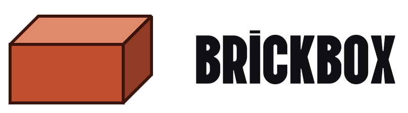
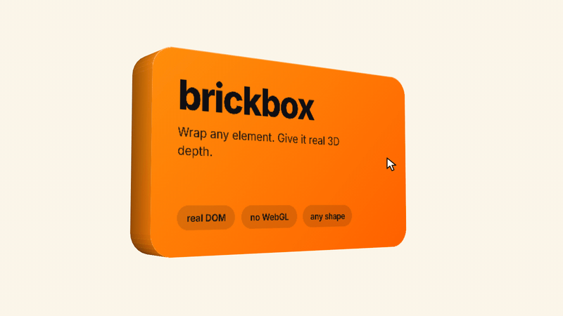
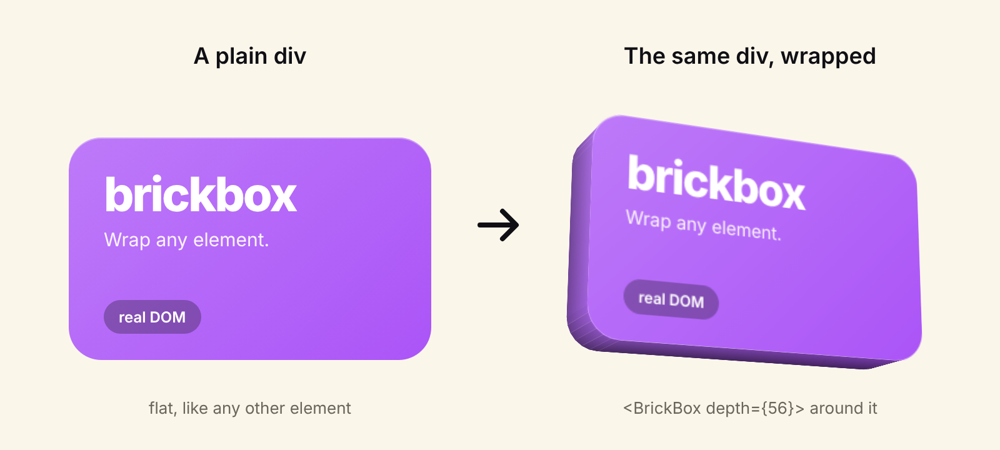
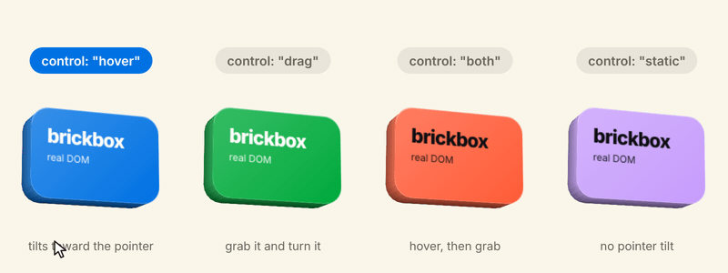
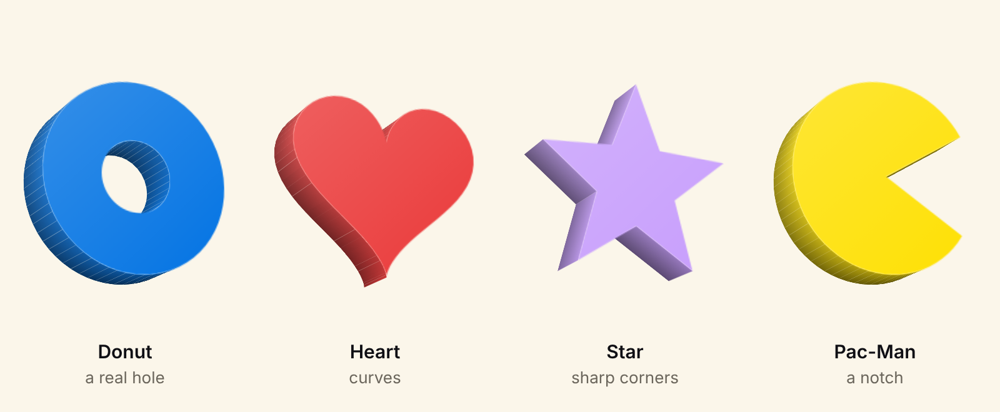
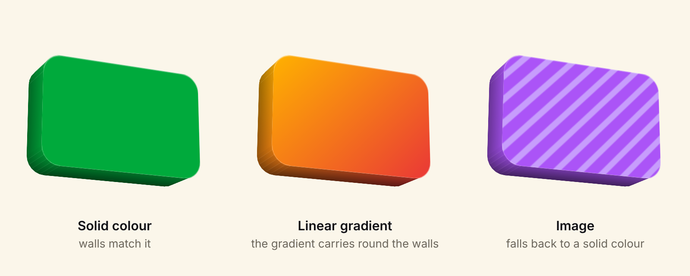
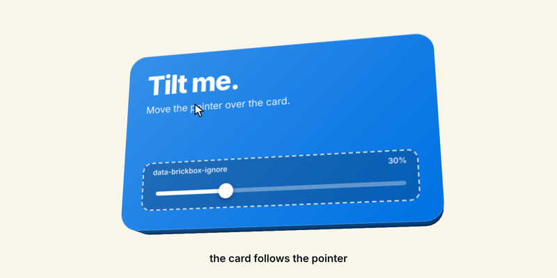
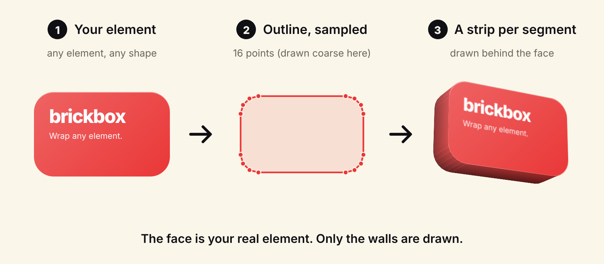

<p align="center">
  <picture>
    <source media="(prefers-color-scheme: dark)" srcset="assets/lockup-on-dark.svg">
    
  </picture>
</p>

<p align="center">
  
</p>

<p align="center">
  <a href="https://www.npmjs.com/package/brickbox"></a>
  <a href="https://github.com/Prashaxt/brickbox/actions/workflows/ci.yml"></a>
  
  
  <a href="https://github.com/Prashaxt/brickbox/blob/main/LICENSE"></a>
</p>

<p align="center">
  <b>Wrap any element. Give it real 3D depth.</b><br>
  The element stays real DOM. brickbox draws the walls behind it.
</p>

<p align="center">
  <a href="#install">Install</a> ·
  <a href="#quick-start">Quick start</a> ·
  <a href="#what-you-can-do">What you can do</a> ·
  <a href="#props-reference">Props</a> ·
  <a href="#guides">Guides</a> ·
  <a href="#troubleshooting">Troubleshooting</a> ·
  <a href="#how-it-works">How it works</a>
  <!-- Website: add a link here once it is live -->
</p>

---

## Why brickbox

Some approaches to 3D on the web ask you to rebuild your element as a box made of faces, or to swap your HTML for a canvas. brickbox wraps the element you already have, adds one prop, and keeps it real DOM.

<p align="center">
  
</p>

```diff
- <div className="card">Hello</div>
+ <BrickBox depth={56}><div className="card">Hello</div></BrickBox>
```

- **Real DOM.** The front face is your element. Its text stays selectable and it stays styled by you. The walls are drawn behind it and marked `aria-hidden`.
- **Any shape.** Rounded corners, elliptical radii and `clip-path` (polygon, circle, ellipse, inset, path), holes included.
- **Colours follow.** Walls match a solid background or continue a linear gradient around the edge.
- **Your pick of pointer behaviour.** Hover, drag, both or static, plus press-to-sink, reverse switches and ignore areas.
- **Tiny.** About 6.5 KB gzipped for the core, and no runtime dependencies.
- **One engine, three ways in.** Plain JavaScript, a React component, or a `<brick-box>` custom element.

**Status:** v0.3.0. This is pre-1.0, so expect small API changes before 1.0.

## Install

```bash
npm i brickbox
```

ESM and CJS builds with TypeScript types are included. React is an optional peer dependency (version 17 or newer) and is only needed for `brickbox/react`.

## Quick start

### React

```tsx
import { BrickBox } from 'brickbox/react';

export function Card() {
  return (
    <BrickBox depth={40}>
      <div className="card">Hello, depth</div>
    </BrickBox>
  );
}
```

### HTML (custom element)

```html
<brick-box depth="40" control="hover" tilt="14 22">
  <div class="card">Hello, depth</div>
</brick-box>

<script type="module">
  import { defineBrickBox } from 'brickbox/element';
  defineBrickBox();
</script>
```

The bare `brickbox/element` import needs a bundler or an import map. To use another tag name, call `defineBrickBox('my-box')`.

### Plain JavaScript

```html
<div id="wrapper">
  <div class="card">Hello, depth</div>
</div>
```

```js
import { brickbox } from 'brickbox';

const box = brickbox(document.getElementById('wrapper'), { depth: 40 });

box.update({ depth: 60 }); // merges new options
box.destroy();             // restores your original markup
```

The wrapper must contain exactly one element child. brickbox builds the 3D structure around it.

> **One rule to remember: layout on the wrapper, looks on the child.**
> Flex, grid, margins and position go on the wrapper (the `BrickBox` or `brick-box` element). Background, radius and padding stay on your child. Put `opacity`, `filter` and `overflow` on the wrapper too, never on the 3D layer, or the 3D flattens.

## What you can do

### Control modes: hover, drag, both, static

<p align="center">
  
</p>

| `control` | What happens |
|---|---|
| `"hover"` (default) | Tilts toward the pointer while it is over the element's real silhouette, then springs back. On touch it behaves like `"drag"`. |
| `"drag"` | Grab and turn. 0.5° per pixel by default, starts after 5 px of movement, clamped to `maxAngle`. A drag suppresses the click that would follow it. |
| `"both"` | Hover until you grab it, and drag takes over while held. On release, hover resumes if the pointer is still over the element, otherwise it springs back. |
| `"static"` | No pointer tilt. The box stays at its resting `tilt`. |

`reverseHover` and `reverseDrag` flip each direction on its own:

```tsx
<BrickBox control="both" reverseDrag>
  <div className="card">Grab me</div>
</BrickBox>
```

### Any shape

<p align="center">
  
</p>

brickbox reads the shape from your element's CSS, so you never describe it twice. Hover, drag and press follow the real silhouette, not the bounding box.

```css
.donut {
  width: 170px;
  height: 170px;
  clip-path: path(evenodd,
    'M5 85 A80 80 0 1 0 165 85 A80 80 0 1 0 5 85 Z M55 85 A30 30 0 1 0 115 85 A30 30 0 1 0 55 85 Z');
}
```

Use `evenodd` for holes. `path()` coordinates are fixed pixels from the element's top-left corner, so give the element the same size as the path. Full list of what is supported, and what is not, is under [Shapes in detail](#guides).

### Colours that follow the face

<p align="center">
  
</p>

```css
.solid    { background: #00AA3C; }
.gradient { background: linear-gradient(135deg, rgb(255, 178, 0), rgb(234, 55, 55)); }
.image    { background-color: #AB54F7; background-image: url(stripes.svg); }
```

A solid background gives solid walls. A single linear gradient with `rgb()` stops is continued around the edge. An image can't be extended onto the walls, so they use the element's background colour instead. To pick the wall colour yourself, set `sideColor="#0F0F14"`.

### Ignore areas

<p align="center">
  
</p>

Mark part of the element with `data-brickbox-ignore`, or pass a selector with `ignore`. Over that area the tilt holds still, and a drag or press can't start there. A drag that began elsewhere keeps going across it.

```tsx
<BrickBox>
  <div className="card">
    <h2>Volume</h2>
    <input type="range" data-brickbox-ignore />
  </div>
</BrickBox>

{/* or: <BrickBox ignore=".knob, .slider"> */}
```

### Press and sink

Set `pressSink` to a percent of `depth` and the face sinks toward the back when pressed, as in the animation at the top. It's off unless you set it. 70 sinks the face most of the way, and 99 is the most it takes.

```tsx
<BrickBox depth={40} pressSink={70} pressDuration={150}>
  <button className="btn">Press me</button>
</BrickBox>
```

A press starts on pointer down and is cancelled as soon as a drag begins.

### Shadows

```tsx
<BrickBox depth={40} shadow="followLight">
  <div className="card">Soft shadow</div>
</BrickBox>
```

`"followLight"` casts the shadow away from `light`, from any direction: light from the top-left puts the shadow at the bottom-right, and light from the right puts it on the left. `"bottom"` always casts it straight down, and `"none"` (the default) turns it off.

Add blur, spread and colour after the mode, in that order, like `box-shadow` without the offsets: `shadow="followLight 12px 2px rgba(0,0,0,.4)"`. What you leave out is chosen from `depth`, and the distance always comes from `depth` too, so a deeper box casts a longer, softer shadow.

The shadow is the flat silhouette of your element, holes included, drawn behind the box, so it doesn't change as the box tilts. An ancestor with `overflow: hidden` will cut it off, so leave it room.

## Props reference

Numbers are px for lengths and degrees for angles. `depth` also accepts a CSS length string. Open a group to see its options.

<details open>
<summary><b>Basics</b></summary>

| Option | Type and allowed values | Default | What it does |
|---|---|---|---|
| `depth` | number, or a CSS length such as `"2rem"` | `24` | How far the box extends back. Units other than px are measured with a hidden probe element. |
| `control` | `"hover"`, `"drag"`, `"both"`, `"static"` | `"hover"` | Pointer behaviour. See [Control modes](#control-modes-hover-drag-both-static). |
| `tilt` | `{ x: number, y: number }` in degrees, negatives allowed | `{ x: 14, y: 22 }` | Resting angle. +x shows the bottom wall and −x the top. +y shows the right wall and −y the left. |
| `perspective` | number (px) | `1000` | Camera distance. Depth beyond about half of this can clip or distort. |
| `disabled` | boolean | `false` | Render the child normally, with no 3D. |

</details>

<details>
<summary><b>Pointer and motion</b></summary>

| Option | Type and allowed values | Default | What it does |
|---|---|---|---|
| `maxAngle` | number (degrees) | `60` | Largest angle hover and drag can reach. |
| `springBack` | boolean | `true` | Return to the resting tilt after release or when the pointer leaves. |
| `springDuration` | number (ms) | `700` | Length of the return animation. |
| `reverseHover` | boolean | `false` | Flip the hover tilt direction. |
| `reverseDrag` | boolean | `false` | Flip the drag direction. |
| `ignore` | CSS selector string | none | Areas inside the element that ignore hover, drag and press. The `data-brickbox-ignore` attribute works too. |
| `touchScroll` | boolean | `true` | Touch only. Vertical swipes scroll the page and only horizontal drags tilt (applies to `control="hover"`). |

</details>

<details>
<summary><b>Press</b></summary>

| Option | Type and allowed values | Default | What it does |
|---|---|---|---|
| `pressSink` | number or string, 0 to 99 (`80` or `"80%"`) | unset (no press) | How far the face sinks when pressed, as a percent of `depth`. Above 99 counts as 99. Unset or `0` means no press. |
| `pressDuration` | number (ms) | `150` | Length of the press transition. |

</details>

<details>
<summary><b>Colour and light</b></summary>

| Option | Type and allowed values | Default | What it does |
|---|---|---|---|
| `sideColor` | `"match"`, or any CSS colour | `"match"` | `"match"` follows the face's background: solid, or a single linear gradient with rgb stops. Any other CSS colour paints the walls that colour. |
| `shading` | boolean | on for `"match"`, off for an explicit colour | Lighting on the walls. |
| `light` | `"top"`, `"top-right"`, `"right"`, `"bottom-right"`, `"bottom"`, `"bottom-left"`, `"left"`, `"top-left"`, or a number (degrees, 0 is top, clockwise) | `"top-left"` (315) | Where the light comes from. |

</details>

<details>
<summary><b>Edge lines</b></summary>

| Option | Type and allowed values | Default | What it does |
|---|---|---|---|
| `edgeColor` | `"none"`, `"auto"`, or any CSS colour | `"none"` | Lines on the back rim and on sharp corners. `"auto"` is a translucent black. |
| `edgeWidth` | number (px) | `1` | Edge line width. |

</details>

<details>
<summary><b>Shadow</b></summary>

| Option | Type and allowed values | Default | What it does |
|---|---|---|---|
| `shadow` | `"none"`, `"followLight"` or `"bottom"`, optionally followed by `blur spread color` | `"none"` | A soft shadow of the silhouette, cast away from `light` or straight down. Blur and spread are in px, and spread may be negative. Defaults: blur equal to `depth`, spread `0`, colour `rgba(0,0,0,.35)`. The distance is 0.6 × `depth` and can't be set separately. |

</details>

<details>
<summary><b>Advanced</b></summary>

Pass these as `advanced={{ ... }}` in React or `advanced: { ... }` in JavaScript. On the custom element only `tolerance` is available, as an attribute.

| Option | Type and allowed values | Default | What it does |
|---|---|---|---|
| `advanced.tolerance` | number (px) | `0.25` | Curve accuracy: how far a wall may stray from the true curve. Lower is smoother and heavier. |
| `advanced.sensitivity` | number | `0.5` | Degrees of tilt per pixel of drag. |
| `advanced.bounce` | number, 0 to 1 | `1` | Overshoot in the return animation. 0 removes it. |
| `advanced.cull` | boolean | `true` | Hide back-facing walls. |

</details>

<details>
<summary><b>React only</b></summary>

| Prop | Type | Default | What it does |
|---|---|---|---|
| `as` | element type | `"div"` | Element type of the outer wrapper. |
| `className`, `style`, `ref` and other HTML attributes | as usual | none | Go on the outer wrapper. Layout props belong here. |
| `children` | exactly one React element | required | The front face. |

`<BrickBox>` renders the whole structure itself, so React owns the DOM, and the core attaches to it. Changing a prop calls `update` for you. The `BrickBoxProps` type is exported from `brickbox/react`.

</details>

<details>
<summary><b>Plain JavaScript API</b></summary>

```ts
import { brickbox } from 'brickbox';
import type { BrickBoxOptions, BrickBoxInstance } from 'brickbox';

const box: BrickBoxInstance = brickbox(wrapperEl, options);
box.update({ depth: 60 });  // merges; a key set to undefined resets to its default
box.destroy();              // removes the structure and restores the original markup
```

Also exported as types: `Advanced`, `Control`, `LightWord`, `Tilt`.

</details>

<details>
<summary><b>Custom element attributes</b></summary>

Attribute names are the kebab-case form of the options. Changing an attribute updates the box live.

| Attribute | Notes |
|---|---|
| `depth` | A number, or a CSS length such as `2rem`. |
| `control` | `hover`, `drag`, `both` or `static`. |
| `tilt` | Two numbers, written `tilt="14 22"` (a comma works too). |
| `max-angle`, `spring-duration`, `press-sink`, `press-duration`, `perspective`, `edge-width` | Numbers. `press-sink` is a percent of depth, 0 to 99. |
| `spring-back`, `shading`, `touch-scroll`, `disabled`, `reverse-hover`, `reverse-drag` | Booleans. Present, or any value except `"false"`, means true. `="false"` means false. |
| `side-color`, `edge-color` | Any CSS colour, plus `match` for `side-color` and `none` or `auto` for `edge-color`. |
| `light` | A word such as `top-left`, or a number in degrees. |
| `ignore` | A CSS selector. |
| `shadow` | A mode, optionally followed by blur, spread and colour: `shadow="followLight 12px 2px rgba(0,0,0,.4)"`. |
| `tolerance` | Number. The only advanced option exposed as an attribute. |

</details>

## Guides

<details>
<summary><b>Layout rules</b></summary>

The wrapper is `display: block`, or `inline-block` when your child is inline-level. Your child stays in normal flow, so its width, height and `margin: auto` keep working. The walls and the pivot follow the child's measured box, and they update when either the child or the wrapper resizes.

Put these on the **wrapper**: flex, grid, margin, position, `opacity`, `filter`, `overflow`.
Put these on the **child**: background, border radius, padding, borders.

Borders stay on the front face. The walls follow the background, never the border colour.

</details>

<details>
<summary><b>Shapes in detail</b></summary>

The silhouette comes from your element's computed `clip-path` if brickbox supports it, and otherwise from `border-radius` (including per-corner and elliptical radii).

**Supported `clip-path`:** `polygon()`, `circle()`, `ellipse()`, `inset()` (with `round`), and `path()`.

**Holes** use even-odd nesting: a shape inside an odd number of others is a hole, and one inside an even number is solid. That handles donuts, frames, a solid centre inside a hole, and separate islands. Use `evenodd` in `path()` for holes.

**Not supported:** `calc()` inside a clip-path, `url(#id)` and `shape()`. These fall back to the rounded rectangle, with a warning in development.

**Good to know:**
- A set `clip-path` overrides `border-radius` for the walls.
- Extra `path()` subpaths must start with an absolute `M`.
- Polygons are clipped to the element's box, because content only exists inside it.
- A polygon with a zero-width slit (a "keyhole") may show a seam.
- A nested `path()` with the same winding and no `evenodd` is treated as a hole by the walls. Use `evenodd` when you mean a hole.

</details>

<details>
<summary><b>Colour matching in detail</b></summary>

With `sideColor="match"`, brickbox reads the child's computed background when the box is built.

- A **solid colour** gives solid walls.
- A **single linear gradient with `rgb()` or `rgba()` stops** is continued around the edge.
- **Anything else** falls back to the element's background colour, or to a neutral grey if that is transparent. That covers images, stacked backgrounds, radial and conic gradients, and stops in px or em.

Walls are shaded by a light angle (`light`, default top-left), and `shading` turns the lighting on or off. With an explicit `sideColor`, shading is off unless you set it.

The colour is read at build time. It does not follow a later colour change, such as a hover transition on the face.

</details>

<details>
<summary><b>Touch</b></summary>

There is no hover on touch screens, so `control="hover"` and `"both"` behave like `"drag"`.

With `touchScroll` on (the default), `control="hover"` uses `touch-action: pan-y`, so vertical swipes scroll the page and only horizontal drags tilt the box. `"drag"` and `"both"` set `touch-action: none`.

</details>

<details>
<summary><b>Server rendering and reduced motion</b></summary>

`<BrickBox>` is designed to be safe on the server: it doesn't touch `window` or `document` while rendering. On the server it renders your element inside the wrapper as normal, and the walls appear after the component mounts in the browser. Automated tests don't cover server rendering yet.

The plain `brickbox()` function and the custom element need a DOM, so call them in the browser.

When the user prefers reduced motion, hover tilt is off and the press and spring transitions are removed.

In development (when `process.env.NODE_ENV` isn't `"production"`), brickbox warns when `depth` is more than half of `perspective` and when a `clip-path` isn't supported.

</details>

## Troubleshooting

<details>
<summary><b>My box looks flat.</b></summary>

`opacity`, `filter` or `overflow` is probably on the child or the 3D layer. Move it to the wrapper.

</details>

<details>
<summary><b>The shape is a rounded rectangle, not my clip-path.</b></summary>

The clip-path uses `calc()`, `url(#id)` or `shape()`, which aren't supported. In development you'll see a warning. Rewrite it as `polygon()`, `circle()`, `ellipse()`, `inset()` or `path()`.

</details>

<details>
<summary><b>The walls didn't change colour when the face did.</b></summary>

Wall colours are read when the box is built. After the colour change, call `box.update({})` (it rebuilds the walls), or set `sideColor` yourself.

</details>

<details>
<summary><b>The walls look clipped or distorted.</b></summary>

`depth` is probably more than about half of `perspective`. Lower the depth or raise `perspective`.

</details>

<details>
<summary><b>The page slows down with many boxes.</b></summary>

Every wall segment is its own element with a 3D transform, so a page full of complex shapes costs more. Raise `advanced.tolerance` for fewer, coarser segments, and use fewer boxes where you can. Boxes that share a `path()` share one sampling, and boxes far off screen wait to build their walls until you scroll close.

</details>

<details>
<summary><b>Nothing happens with <code>&lt;brick-box&gt;</code>.</b></summary>

Check that you called `defineBrickBox()`, and that the element has exactly one element child.

</details>

<details>
<summary><b><code>:active</code> or <code>onPointerDown</code> on my element fires before a drag.</b></summary>

That's a known limit, and it only applies when `pressSink` is set. A press is cancelled when a drag starts, but handlers and `:active` styles on your own element can fire first. Put buttons and inputs inside a `data-brickbox-ignore` area and brickbox won't start a press or drag on them.

</details>

## How it works

<p align="center">
  
</p>

Your element is the front face. brickbox samples its outline, turns each segment into one thin strip, and stands the strips behind the face as the wall. Strips beat stacked copies of the element: there are no gaps at steep angles, and the cost depends on the number of outline segments, not on depth.

```
wrapper          takes part in your layout
  perspective    sets the camera distance
    obj          rotates
      sink       moves back when pressed
        child    your element: the front face
        walls    thin strips, aria-hidden, no pointer events
```

Everything is inline styles, so there's no stylesheet to import.

## Every brickbox promises

1. **The element stays real.** It's your DOM, not a copy.
2. **Tiny, no dependencies.** Anything that adds more than about 0.3 KB gzipped needs a discussion.
3. **Quiet at rest.** No timers or loops while it's idle.
4. **Gentle with the page.** No layout changes, walls are `aria-hidden`, and reduced motion is respected.
5. **Safe on the server.** No `window` or `document` access while rendering.
6. **Honest about limits.** See below.

## Good to know

- **Browsers.** The author tested desktop and phone browsers. Safari, Firefox and older mobile browsers aren't verified.
- **Tests.** The 50 automated tests cover geometry and option parsing only. There are no DOM or browser tests yet.
- **Colour.** Images and other complex backgrounds fall back to a solid wall colour, and wall colours don't follow a later colour change.
- **Not extruded.** `box-shadow` and `outline` are not extruded. Borders stay on the front face.
- **Depth.** Depth beyond about half of `perspective` can clip or distort.
- **Press then drag.** Handlers on your own element can fire before a drag cancels the press.
- **Size.** About 6.5 KB gzipped for the core (v0.2.0). The React wrapper adds about 0.65 KB and the custom element about 0.75 KB.
- **Version.** Pre-1.0: small API changes are possible.

## Contributing

Issues and pull requests are welcome. Please read [CONTRIBUTING.md](https://github.com/Prashaxt/brickbox/blob/main/CONTRIBUTING.md) first, and keep to the six promises above.

```bash
git clone https://github.com/Prashaxt/brickbox.git
cd brickbox
npm install
npm run typecheck && npm test && npm run build && npm run size
```

See the [changelog](https://github.com/Prashaxt/brickbox/blob/main/CHANGELOG.md) for what changed in each release.

## Licence

[MIT](https://github.com/Prashaxt/brickbox/blob/main/LICENSE)