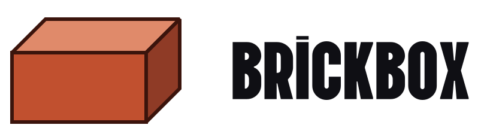
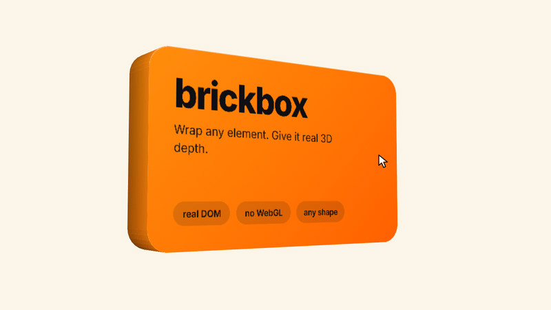
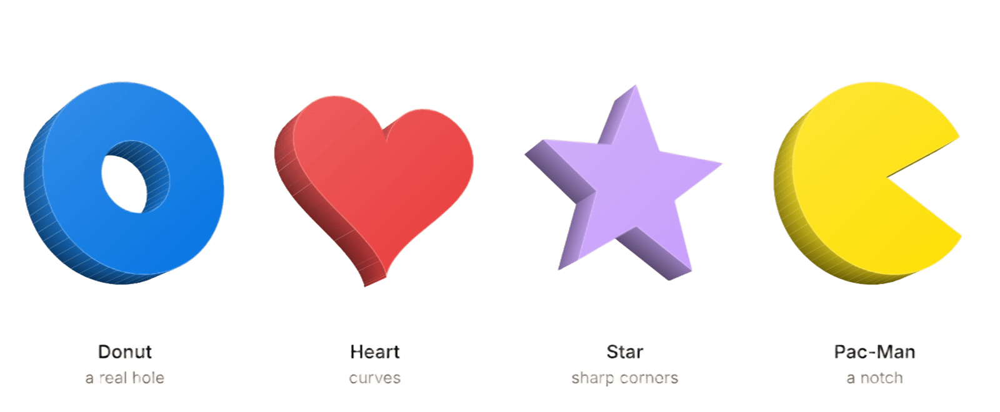

<p align="left">
  
</p>
<p align="left">
  <b>Wrap any element. Give it real 3D depth.</b><br>
  The element stays real DOM. brickbox draws the walls behind it.
</p>

<p align="center">
  
</p>


<p align="center">
  <a href="https://brickbox.js.org/docs"></a>
  <a href="https://brickbox.js.org/playground"></a>
</p>

<p align="center">
  <a href="https://www.npmjs.com/package/brickbox"></a>
  
  <a href="https://github.com/Prashaxt/brickbox/blob/main/LICENSE"></a>
</p>

<p align="center">
  <a href="https://brickbox.js.org">Website</a> ·
  <a href="https://brickbox.js.org/docs">Docs</a> ·
  <a href="https://brickbox.js.org/playground">Playground</a> ·
  <a href="https://github.com/Prashaxt/brickbox">GitHub</a> ·
  <a href="https://github.com/Prashaxt/brickbox/blob/main/CHANGELOG.md">Changelog</a>
</p>

- **Real DOM.** Your element is the front face, so its text stays selectable and it stays styled by you.
- **Any shape.** Rounded corners and `clip-path`, holes included.
- **Colours follow.** Walls match your background, even when it changes.
- **Alive.** Hover, drag, press-to-sink, soft shadows that follow the light.
- **Parts on parts.** Nest boxes to build physical buttons on a tilting panel.
- **Small.** No dependencies, about 10 KB gzipped.
- **Three ways in.** Plain JavaScript, React, or a `<brick-box>` custom element.

## Install

```bash
npm i brickbox
```

## Quick start

**React**

```tsx
import { BrickBox } from 'brickbox/react';

export function Card() {
  return (
    <BrickBox depth={40}>
      <div className="card">Hello, depth</div>
    </BrickBox>
  );
}
```

**HTML**

```html
<brick-box depth="40" control="hover">
  <div class="card">Hello, depth</div>
</brick-box>

<script type="module">
  import { defineBrickBox } from 'brickbox/element';
  defineBrickBox();
</script>
```

**Plain JavaScript**

```js
import { brickbox } from 'brickbox';

const box = brickbox(document.getElementById('wrapper'), { depth: 40 });
box.update({ depth: 60 });
box.destroy();
```

The most-used options, in one place:

```tsx
<BrickBox
  depth={40}              // how far it extends back
  control="both"          // "hover", "drag", "both" or "static"
  pressSink={70}          // sink 70% of its depth when pressed
  shadow="followLight"    // a soft shadow that follows the light
>
  <div className="card">…</div>
</BrickBox>
```

> **Layout on the wrapper, looks on the child.** Flex, grid, margins and position go on the wrapper. Background, radius and padding stay on your element. Put `opacity`, `filter` and `overflow` on the wrapper too, never on the child, or the 3D flattens.

Every option, with defaults and examples, is in the **[documentation](https://brickbox.js.org/docs)**, and you can try them live in the **[playground](https://brickbox.js.org/playground)**.

The official website is available at **[brickbox.js.org](https://brickbox.js.org/)** 

## When to use it

Reach for brickbox when you want real 3D depth on ordinary page elements, without WebGL or a rewrite:

- **3D tilt cards** that lean toward the pointer, or turn when you drag them
- **Physical buttons and keys** that sink when pressed, even standing on a tilting panel
- **Extruded shapes**, from logos and badges to anything you can cut with `clip-path`, holes included
- **Depth on real UI**, such as cards, tiles, buttons and dashboards, while the element stays real DOM

Use something else if you need full 3D scenes, models or textures (try Three.js), or if you want to extrude the letters of text or show an image on the walls. Walls are solid colours or gradients.

## What you can do

<p align="center">
  
</p>

- **Control modes.** Tilt on hover, grab and turn, both, or none.
- **Press and sink.** `pressSink` pushes the face in when pressed.
- **Shadows.** `shadow` casts a soft shadow of the real silhouette, away from the light, and it follows the tilt.
- **Colour and light.** Solid or gradient walls that follow the face, lit from any direction.
- **Ignore areas.** Mark a slider or a button and the box holds still over it.
- **Nesting.** `lift` makes a box a part standing on its parent:

```html
<brick-box depth="36" control="drag" shadow="followLight">
  <div class="remote">
    <brick-box lift="0" depth="12" press-sink="65"><button>OK</button></brick-box>
    <brick-box lift="12" depth="8" press-sink="60"><button>GO</button></brick-box>
  </div>
</brick-box>
```

See each one in the **[docs](https://brickbox.js.org/docs)** and play with them in the **[playground](https://brickbox.js.org/playground)**.

## Good to know

- Walls follow a solid background or a single linear gradient. Images and radial or conic gradients use a solid wall colour instead.
- `box-shadow` and `outline` are not extruded, and borders stay on the front face.
- `clip-path` supports `polygon()`, `circle()`, `ellipse()`, `inset()` and `path()`, including `calc()` lengths. `url()` and `shape()` are not supported.
- Every wall strip is a DOM element, so a page full of very complex shapes costs more than a few simple ones.
- Tested in Chrome, Firefox and Safari. It needs CSS 3D transforms.

## Contributing

Issues and pull requests are welcome on [GitHub](https://github.com/Prashaxt/brickbox). Please read [CONTRIBUTING.md](https://github.com/Prashaxt/brickbox/blob/main/CONTRIBUTING.md) first.

## Licence

[MIT](https://github.com/Prashaxt/brickbox/blob/main/LICENSE)
